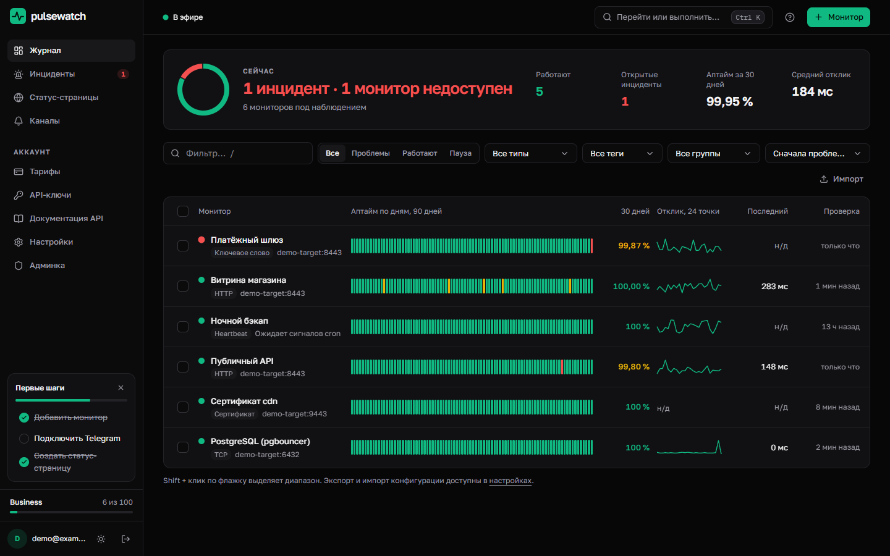
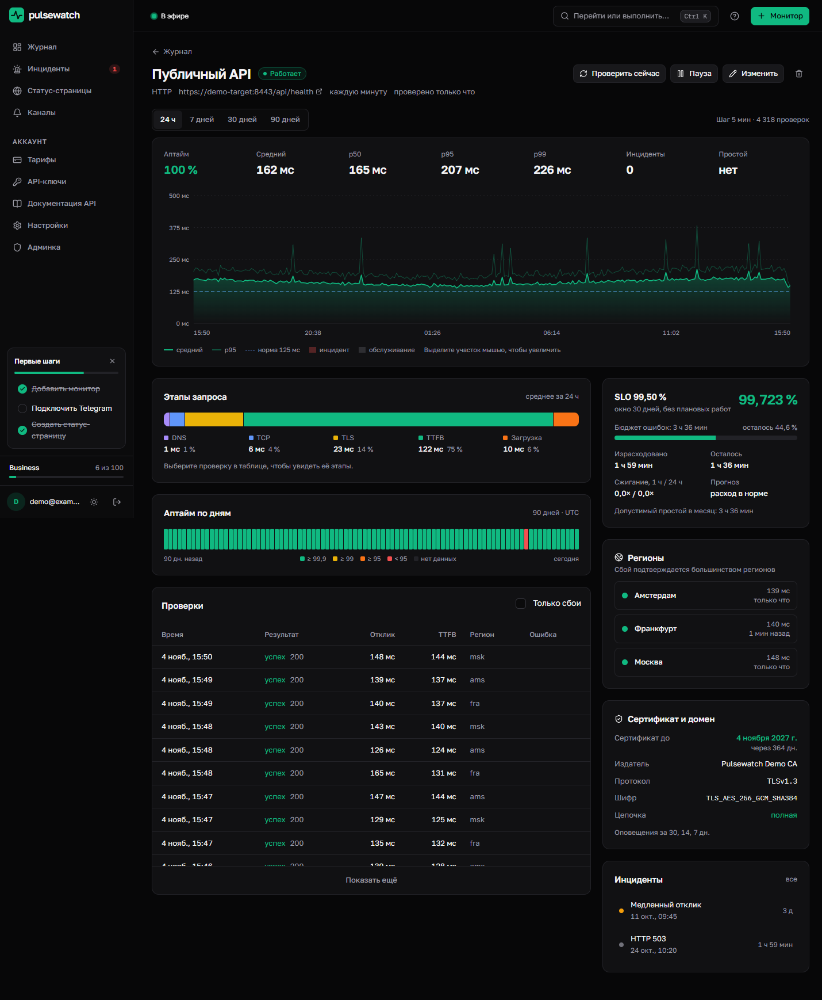
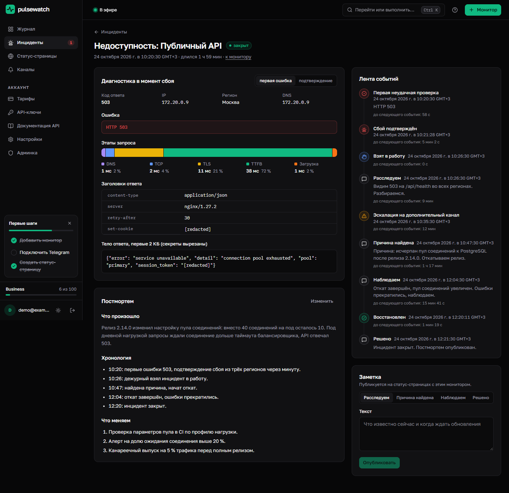
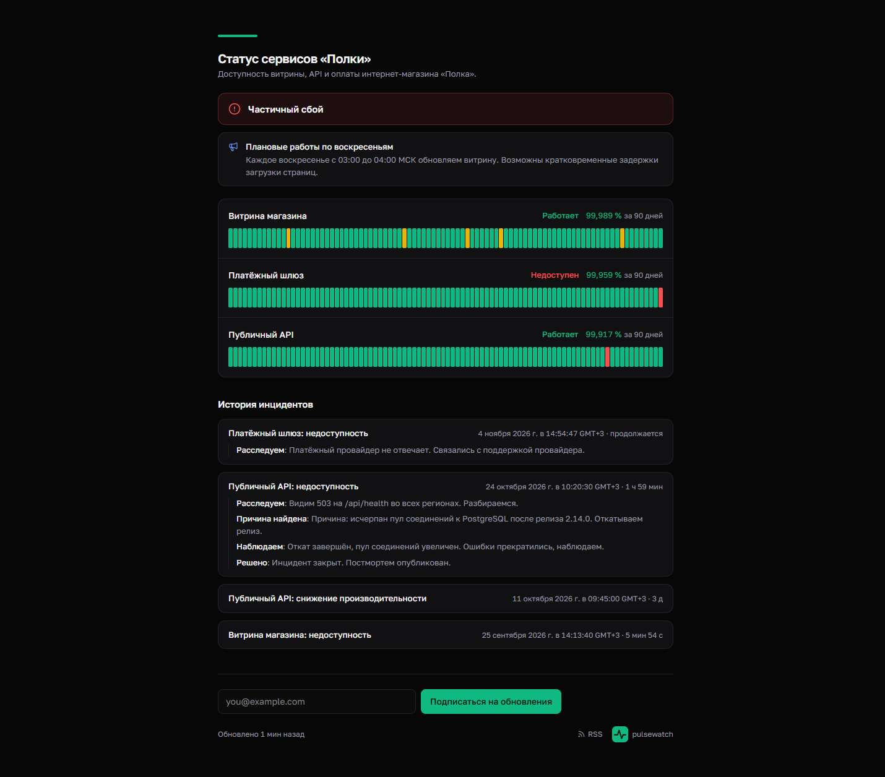
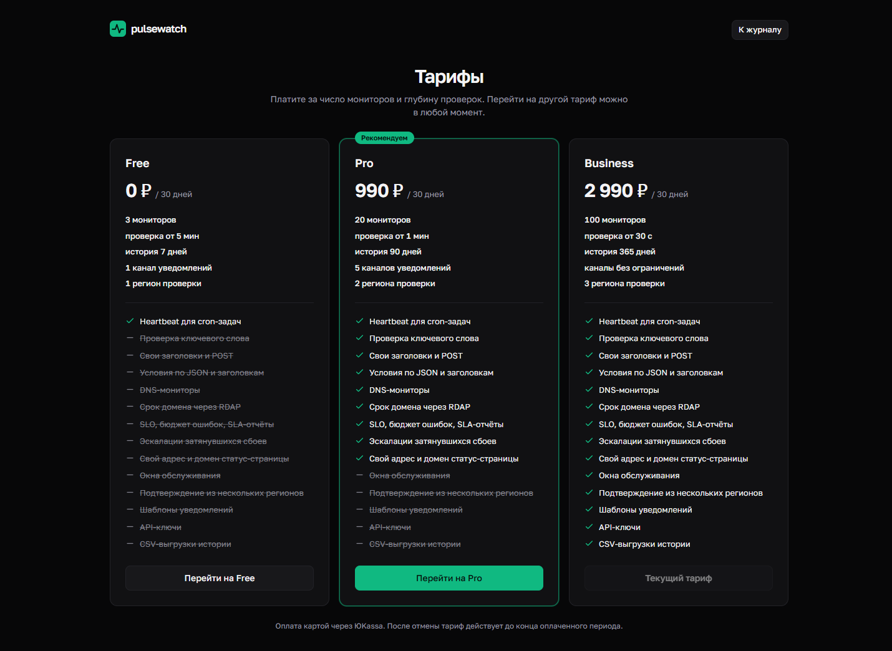
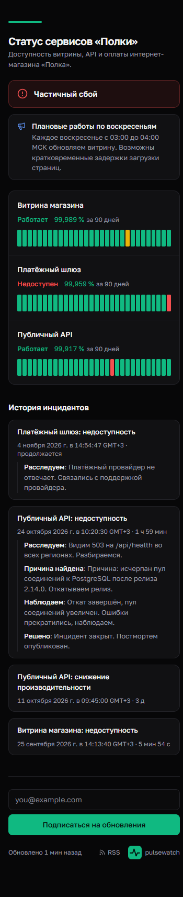
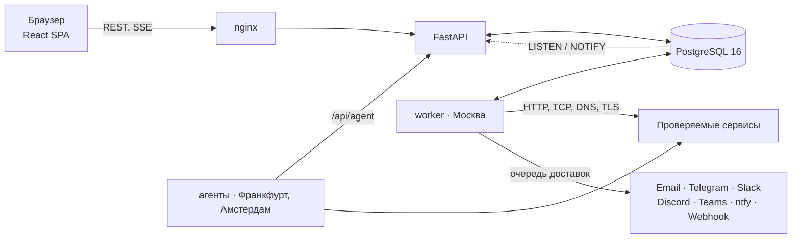

# Pulsewatch

Pulsewatch проверяет сайты, API, TCP-сервисы, DNS и сертификаты из нескольких регионов, открывает инциденты только после подтверждения сбоя и сообщает о них в нужные каналы и на публичную статус-страницу.

[](https://github.com/hmsusbusas-png/pulsewatch/actions/workflows/backend.yml)
[](https://github.com/hmsusbusas-png/pulsewatch/actions/workflows/frontend.yml)
[](LICENSE)



| Монитор | Инцидент |
| --- | --- |
|  |  |
| **Публичная статус-страница** | **Тарифы** |
|  |  |

<p align="center"></p>

## Возможности

- Типы проверок. HTTP, поиск ключевого слова, TCP с отправкой строки и ожидаемым баннером, DNS (A, AAAA, CNAME, MX, TXT, NS), отдельная проверка сертификата, heartbeat для cron-задач и бэкапов.
- Утверждения о HTTP-ответе. JSONPath, заголовки и тело; операторы равенства, вхождения, регулярного выражения, наличия и сравнения чисел. Утверждения можно проверить на последнем сохранённом ответе.
- Этапы запроса. DNS, TCP, TLS, TTFB и загрузка для каждой HTTP-проверки, водопад по выбранной проверке.
- Регионы. основной worker и региональные агенты, которые забирают задания через API своим токеном. Сбой подтверждается большинством регионов. В демо агенты «Франкфурт» и «Амстердам» работают в локальных контейнерах; для настоящей географии агент запускается на сервере в нужном регионе (`python -m app.agent`).
- Инциденты. лента «Расследуем → Причина найдена → Наблюдаем → Решено», подтверждение получения, постмортем в Markdown. При сбое сохраняется диагностика: IP, редиректы, заголовки и тело ответа, секреты в них маскируются.
- Аномалии. базовая линия отклика по медиане и MAD, инцидент «медленный отклик» при устойчивом отклонении.
- SLO и отчёты. бюджет ошибок, скорость его расходования, прогноз, отчёт SLA за период без учёта плановых работ.
- Сертификаты и домены. срок сертификата и цепочка, срок регистрации домена по RDAP, напоминания за 30, 14 и 7 дней.
- Уведомления. email, Telegram, Slack, Discord, Microsoft Teams, ntfy и webhook с HMAC-подписью; шаблоны сообщений и эскалации, если инцидент не подтвердили.
- Статус-страницы. аптайм за 90 дней по дням, история инцидентов с заметками, объявления, логотип и акцент, свой домен через CNAME, подписка по email, RSS, SVG-бейдж.
- Живой интерфейс. события по SSE, командная палитра (Ctrl/Cmd+K), горячие клавиши, оптимистичные изменения с откатом, отмена удаления в течение 7 секунд, массовые действия, импорт и экспорт конфигурации.
- API. OpenAPI с каталогом ошибок, API-ключи на чтение или запись, Idempotency-Key, курсорная пагинация с Link, заголовки X-RateLimit-\*, единый формат ошибок с request_id.
- Тарифы. Free, Pro и Business с лимитами на мониторы, интервал, хранение истории и регионы; оплата через ЮKassa, в dev работает тестовый провайдер.

## Архитектура



## Быстрый старт

Нужны Docker с Compose v2 и Python 3.

```sh
python scripts/make_env.py
docker compose --profile demo up -d --build --wait
docker compose exec backend python -m app.seed --demo
```

Последняя команда один раз печатает пароль демо-аккаунта. Свой пароль можно задать через `--password`. Интерфейс: http://localhost:8080, вход `demo@example.com`. API и документация: http://localhost:8000/docs.

Профиль `demo` поднимает демо-цель с TLS, TCP и приёмником вебхуков, а также два региональных агента. Демо-данные за 90 дней включают сезонность отклика, три инцидента (длинный с заметками и постмортемом, деградацию и текущий сбой), статус-страницу с подписчиком и историю доставок. Повторный запуск пересоздаёт демо-аккаунт.

На Windows то же самое делает `./dev.ps1`, он дополнительно запускает Vite на http://127.0.0.1:5173.

## Как это устроено

**Планировщик.** Worker выбирает мониторы с наступившим `next_check_at` через `SELECT … FOR UPDATE SKIP LOCKED` и ставит аренду с токеном на 10 минут. Результат записывается, только если токен совпадает, поэтому несколько worker'ов не дублируют проверку. Новый монитор и «Проверить сейчас» будят worker через `pg_notify`, не дожидаясь следующего такта. Региональные агенты получают задания через `/api/agent/claim` и возвращают результаты своим токеном.

**Подтверждение сбоя.** Инцидент открывается после `failure_threshold` неудачных проверок подряд. Если регионов несколько, у каждого свой счётчик, и сбой подтверждается, когда порог превышен в большинстве регионов. Открытый инцидент одного вида на монитор гарантирует частичный уникальный индекс.

**Свёртки.** Триггер PL/pgSQL на вставку в `checks` обновляет `daily_uptime`: число проверок, сбоев, сумму откликов и гистограмму по 44 корзинам задержки. Графики до 7 дней строятся по сырым проверкам с `percentile_cont` и прореживанием через `width_bucket`, за 30 и 90 дней по суточным свёрткам, перцентили берутся из гистограммы. Сырые проверки хранятся по сроку тарифа.

**Очередь доставок.** Уведомление пишется в `notification_deliveries` в той же транзакции, что и инцидент. Доставка at-least-once: пять попыток с экспоненциальной паузой, `Retry-After` учитывается. Адреса вебхуков проходят ту же SSRF-проверку, что и цели мониторинга, соединение идёт на проверенный IP.

**Шифрование.** Заголовки проверок, настройки каналов, тела ответов для диагностики, письма в очереди и ответы для Idempotency-Key шифруются Fernet. Ротация ключей: `FERNET_PREVIOUS_KEYS` и `python -m app.rotate_keys` (подробности в [backend/README.md](backend/README.md)).

**Живые обновления.** Изменения публикуются через `pg_notify`. API держит одно соединение LISTEN и раздаёт события подписчикам SSE. Для подключения нужен одноразовый токен на 60 секунд, раз в 20 секунд уходит heartbeat, число потоков на пользователя ограничено.

## Версионирование API

Текущая версия контракта `2026-11-04` приходит в заголовке `X-API-Version` каждого ответа. Добавление полей, эндпоинтов и значений перечислений не считается ломающим изменением. Удаление и переименование полей, смена типов и кодов ответа публикуются в [CHANGELOG](backend/CHANGELOG.md) с новой датой версии. Ошибки возвращаются в формате `{code, message, details, request_id}`, каталог кодов есть в OpenAPI (`/docs`).

## Проверки

Backend: ruff, mypy, pytest на отдельной PostgreSQL с порогом покрытия, pip-audit, миграции с нуля и откат. Frontend: ESLint, TypeScript, сборка с контролем размера, Playwright на зафиксированных ответах API (все экраны на 360 и 1440 px, axe, горизонтальная прокрутка, палитра, отмена удаления, SSE, оптимистичные изменения). Всё это запускает CI вместе с Gitleaks и сборкой Docker-образов. Живой сценарий Playwright (`npx playwright test --project=live`) запускается на поднятом демо-стеке.

SVG-бейдж доступности отдаётся по `GET /api/badge/{slug}.svg`.

## Документы

- [backend/README.md](backend/README.md): переменные окружения, запуск без Docker, тесты, ротация ключей
- [backend/CHANGELOG.md](backend/CHANGELOG.md): изменения контракта API
- [SECURITY.md](SECURITY.md): как сообщить об уязвимости
- [LICENSE](LICENSE)
